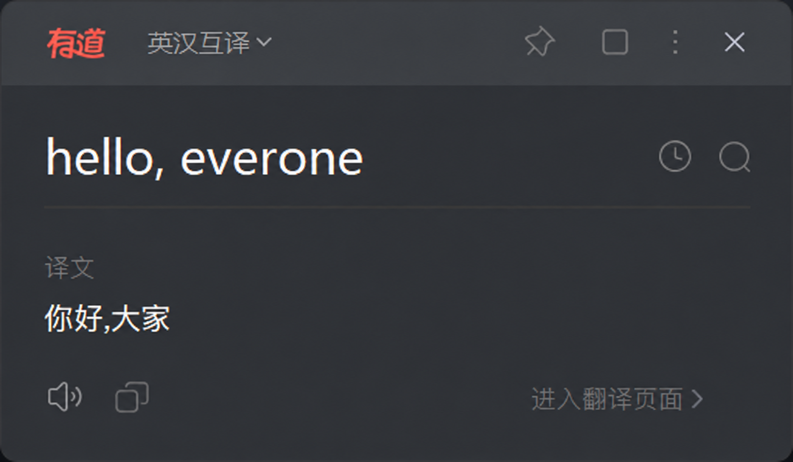
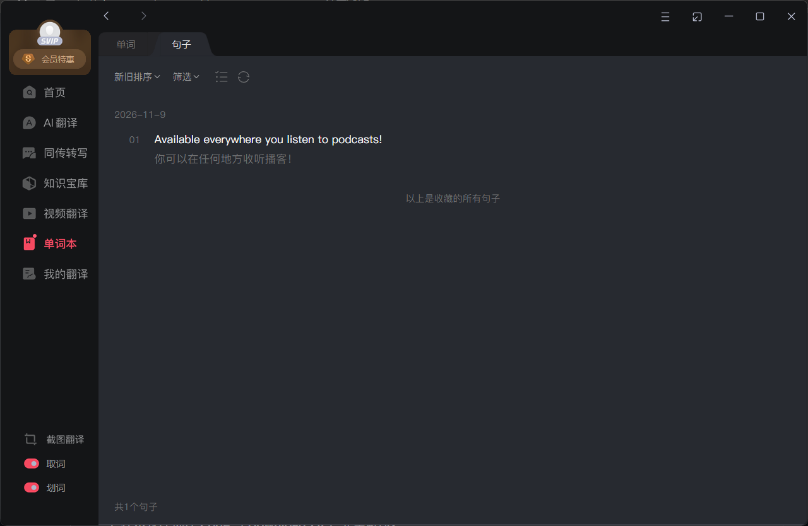
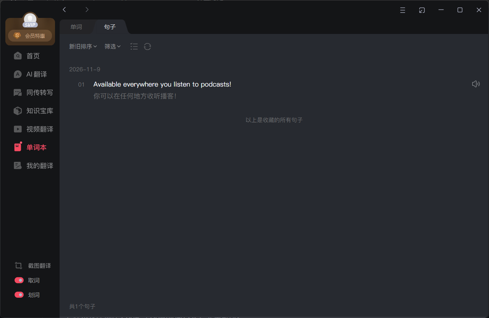

# Youdao Sentence Tools

[](https://github.com/heathfris/youdao-sentence-tools/actions/workflows/test.yml)

为 Windows 有道翻译的 mini 浮窗补上句子收藏与英文原文朗读，并为“单词本 → 句子”增加逐条朗读按钮。

当前适配 **11.3.26.0**，界面功能对应已验证的**修订 5**。项目在本机读取客户端资源、生成补丁和原始文件备份。

## 功能

| 位置 | 使用方式 |
| --- | --- |
| mini 整句结果 | 左侧“译文”喇叭播放译文；右侧“原文”喇叭播放完整英文 |
| mini 句子收藏 | 星标保存到原有账号的“单词本 → 句子”，再次点击取消 |
| 句子本 | 每条原句右侧的喇叭播放对应英文，点击不会勾选整行 |
| 播放控制 | 再次点击停止；换句、切换播放和离开句子本时停止对应音频 |

朗读沿用客户端现有的 `VoicePlayer`、英美音和语速设置。搜索高亮、长句折叠、排序和批量选择继续使用原有组件。

## 界面对比

### mini 浮窗

同一句 `hello, everone`：扩展后增加“原文”英文朗读和句子收藏星标，原有译文朗读继续保留。

| 扩展前（界面示意） | 安装扩展后（实际截图） |
| --- | --- |
| <a href="docs/images/mini-before-illustration.png"></a> | <a href="docs/images/mini-after.png"></a> |

### 句子本

前后均展示同一条收藏内容。扩展后在原句右侧新增英语朗读喇叭，点击播放不会勾选整条记录。

| 扩展前 | 安装扩展后 |
| --- | --- |
| <a href="docs/images/sentencebook-before.png"></a> | <a href="docs/images/sentencebook-after.png"></a> |

句子本前后均为有道翻译 11.3.26.0 的实际截图。以上所有图片均可点击放大。

## 安装

需要 **Windows、匹配指纹的有道翻译 11.3.26.0、Node.js 22 或以上**。项目没有第三方 npm 依赖。

1. 在本仓库选择 **Code → Download ZIP**，完整解压。
2. 从系统托盘完全退出有道。
3. 双击 **安装.cmd**。
4. 工具会尝试寻找安装位置；找不到时，输入包含 `YoudaoDict.exe` 的目录。
5. 安装完成后重新打开有道。

也可以明确指定安装目录：

```powershell
powershell.exe -NoProfile -ExecutionPolicy Bypass -File .\Apply-Patch.ps1 -Action Install -ApplicationDirectory 'D:\Apps\Youdao\Dict'
```

首次运行会在 `local/` 中保存原始文件、生成的补丁和本机安装位置。请保留这个目录供恢复使用；它已被 Git 忽略。

原版及已安装修订 4/5 的主题扩展可直接使用。更早的修订 2/3 修改过入口文件，需要先用旧补丁自带的恢复工具还原入口。

## 检查和恢复

- **检查状态.cmd**：显示四份入口文件为 `Original`，主题脚本为 `Patched` 时，表示本修订已经安装。
- **恢复原版.cmd**：从本机备份恢复原始界面文件，运行前同样需要完全退出有道。

安装工具会检查程序版本、入口、播放器和相关资源的指纹。未知文件会拒绝覆盖。安装失败时会尝试把本次涉及的目标文件恢复为操作前的内容。

收藏数据继续由有道自身的账号与句子本管理。

## 项目结构

```text
source/
  voice-ui.cjs        英语按钮、浮窗与句子本接入
  install-ui.cjs      收藏星标与原客户端账号状态连接
  collector.cjs       收藏查询、保存、取消与请求状态
  entry-ui.cjs        在原组件加载时接入扩展
  extension.cjs       组装浏览器端扩展
  build.cjs           从本机安装生成补丁和备份
profiles/             适配版本、模块信息与文件指纹
Apply-Patch.ps1       安装、恢复和检查
local/                本机生成内容，已被 Git 忽略
```

构建器从本机已验证的主窗口脚本提取现有请求辅助模块，为 mini 复用原来的收藏请求封装。账号、公共参数和签名继续交给客户端处理。

## 开发与验证

```powershell
npm test
npm run build -- 'D:\Apps\Youdao\Dict'
```

`build` 只生成 `local/` 内容，安装由 `Apply-Patch.ps1` 单独执行。

公开版包含 24 项自动测试，覆盖收藏请求与竞态、原生登录状态、英文文本编码、按钮顺序、播放停止、组件接入，以及构建时的指纹和备份保护。测试使用自行编写的模拟数据，可在没有有道安装的环境运行。

本机生成的修订 5 主题脚本与人工确认正常的版本逐字节一致。用户已确认 mini 查词、英文原文与中文译文朗读、收藏和登录状态正常，句子本朗读也已确认。

两种整句组件均有组件级验证；强制调用备用原生翻译接口的完整联网流程未得到确认。跨设备同步和物理断网后的语音行为尚未验证。

实现过程见 [docs/implementation.md](docs/implementation.md)，验证范围见 [docs/verification.md](docs/verification.md)。

## 客户端资源

本仓库发布新增的扩展、构建工具和测试。原始客户端文件、包含客户端模块的生成物、本机账号数据和诊断记录保留在使用者本机。

这是面向上述客户端版本的个人扩展项目。

## 许可

本仓库新增的扩展、工具与测试按 [MIT License](LICENSE) 发布。本机有道客户端及构建时读取的原模块适用各自的许可与权利声明。
