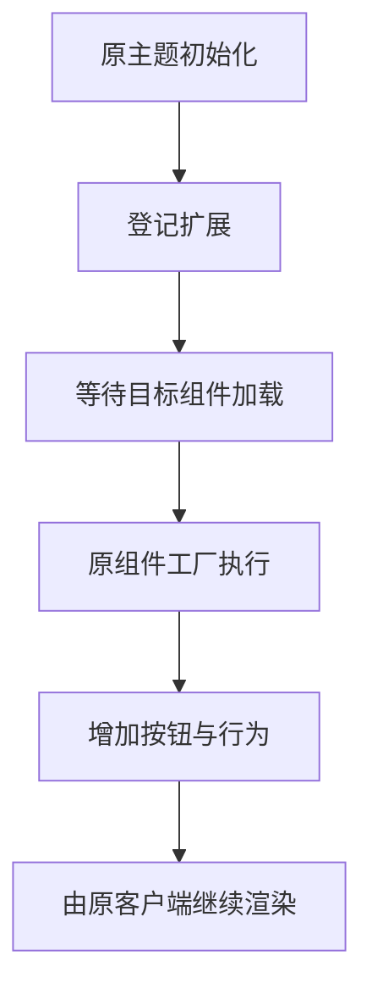

# 实现说明

## 最终改动

相对原版，运行时补丁只向 `libs/theme-init.js` 追加扩展。原主题初始化继续执行；mini 与主窗口的 JavaScript 入口、HTML 及其完整性值均保留原样。

已验证的修订 5 中，mini 工具栏顺序为“译文＋喇叭、原文＋喇叭、复制、收藏”。标签放在各自图标前，明确对应关系。

## 共用英语按钮

`createEnglishSpeaker` 通过 Vue 创建包装组件，接收 `text` 与 `label` 两个 props。原文去除首尾空白后编码，作为 `word` 交给客户端已有的 `VoicePlayer`，并附上 `le=en`。

```js
Vue.h(VoicePlayer, {
  ref: player,
  word: text.value ? encodeURIComponent(text.value) + '&le=en' : '',
  disabled: !text.value
})
```

例如 `I like learning English.` 会传为 `I%20like%20learning%20English.&le=en`。播放器继续负责音频请求、分段播放、英美音和语速。

包装组件观察原文变化，并在移除或被缓存停用时停止自己拥有的播放。点击文字会转交播放器；点击原喇叭时沿用原处理，避免重复触发。事件停止冒泡，防止句子本整行被误选。

## 两处接入

mini 的两种整句结果分别从 `result.source` 和 `keyword` 取得原文。扩展调用原组件的渲染函数，再在工具栏的虚拟节点中加入按钮。

句子本直接读取记录的 `original`，保留原 `setup`、作用域样式、文字引用和折叠测量。原句右侧预留 40 像素给喇叭，搜索高亮标签不会进入语音文本。

## 收藏

`collector.cjs` 管理当前原文、译文、语言、收藏 ID 和请求状态。它复用原有句子收藏接口，服务器成功返回 ID 后才显示已收藏。

请求期间阻止重复提交。每次切换句子或账号状态都会递增版本号，旧请求只能更新仍属于同一轮的界面。请求结果不确定时先重新查询，避免盲目重复保存。

`install-ui.cjs` 通过客户端已有账号逻辑读取登录状态，并复用已有签名请求封装。mini 界面中某个默认的登录标志不能代表原生账号是否登录，因此不使用该默认值启动登录流程。

## 加载顺序

发布的 JavaScript 使用 webpack 模块。扩展在运行时就绪后登记目标模块的工厂包装：原工厂先执行，再扩展生成的组件。



早期修改入口脚本和 HTML 时出现过“查词请求发出但没有回调”。原版对照可正常查询；保留原入口与 HTML、改为主题脚本扩展后，真实单词与整句查询恢复。具体原生校验或初始化原因仍未完全确定。

模块编号和文件指纹固定在 `profiles/11.3.26.0.json`，其他版本需要重新分析与验证。

## 逆向与验证方法

分析结合 `rg` 搜索、Node.js 检查打包模块，以及 REA 的 `analyze_javascript_application` 静态分析。REA 负责提取模块与静态关系；这些结果不等于运行证明。

运行阶段另用受控本机诊断确认请求数据、语言参数和实际媒体播放，再通过日常操作与人工听音确认。公开仓库只保留实现说明与自编测试，原始诊断数据留在本机。

## 构建与恢复

公开构建器先验证本机程序和全部依赖，再提取现有请求辅助模块并生成扩展。原始文件、生成文件及安装路径写入被忽略的 `local/`。

已知的修订 4/5 可以通过已验证的原主题前缀恢复原始主题内容。未知版本或损坏的原始备份在写入前被拒绝。

安装器先验证生成文件，再通过临时文件替换目标；失败时尝试回滚。恢复操作使用本机原始备份。
